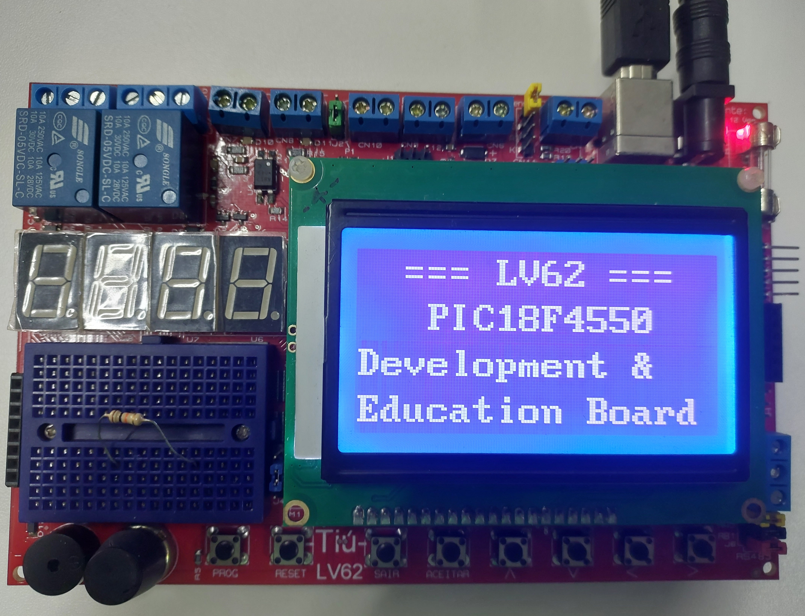

# 4x16 Text-Mode GLCD (ST7920)

## Overview

This firmware example demonstrates text output on a 128×64 graphical LCD using the ST7920 controller in text mode. The display is configured for four lines of 16 characters each.

## Hardware

- **Development board:** LV62
- **Microcontroller:** PIC18F4550-I/PT
- **Display controller:** ST7920
- **Compiler:** MPLAB X IDE with XC8 v3.10
- **Clock frequency:** 48 MHz

## Connections

| ST7920 signal | LV62 connection |
|---|---|
| D7 | RD3 |
| D6 | RD2 |
| D5 | RD1 |
| D4 | RD0 |
| RST | RE0 |
| E | RE1 |
| RS | RE2 |
| Backlight control | RC1 / CCP2 |

The display data interface uses four bits (D4–D7).

## Important Configuration

The firmware configures the analog-capable pins as digital I/O using:

```c
ADCON1 = 0x0F;
```

This configuration is required for correct operation of the GLCD interface.

The firmware uses a 48 MHz clock. Ensure that the project configuration matches the hardware clock setup.

## MPLAB X Project Setup

1. Create or open a PIC18F4550 project in MPLAB X IDE.
2. Select the XC8 compiler.
3. Add `4x16_text_mode_glcd.c` to the project.
4. Configure the project for the LV62 hardware and a 48 MHz clock.
5. Set **XC8 Linker → Code Offset** to `0x1000` to preserve the LV62 HID bootloader.

**Important:** Verify the linker Code Offset setting for every new project. Do not leave it blank.

## Demonstration

The program initializes the ST7920 display and writes text to its four 16-character lines.

## License

Refer to the repository's license, if applicable.

## Photograph

<p align="center">
  
</p>

