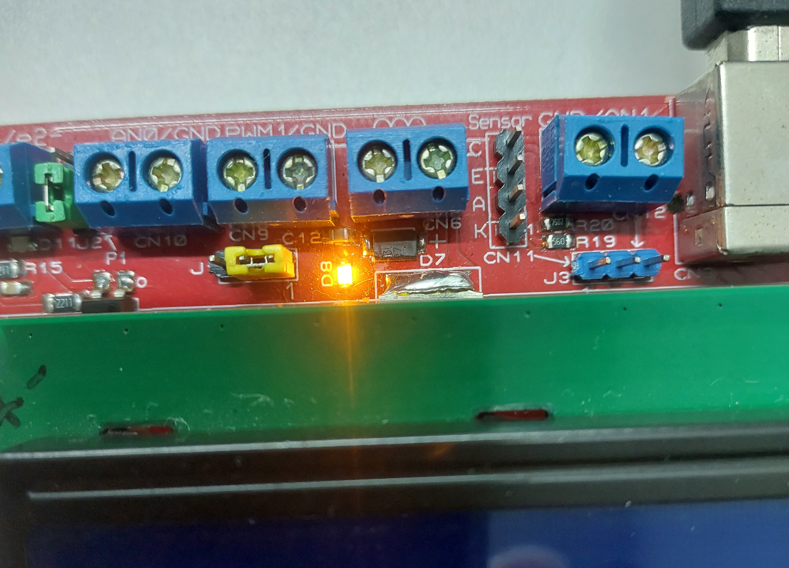

# CCP1 PWM LED Control

## Overview

This firmware example demonstrates Pulse Width Modulation (PWM) using the CCP1 peripheral of the PIC18F4550. The PWM output drives the LV62 board's on-board orange LED (D8), allowing the effect of duty-cycle changes to be observed.

The firmware automatically cycles through five duty-cycle settings: 0%, 25%, 50%, 75%, and 100%, holding each setting for one second.

The CCP1 output can also be connected through the LV62 jumper to the BUK9614 power MOSFET gate to control an external load.

## Hardware and Software

- **Development board:** LV62
- **Microcontroller:** PIC18F4550
- **Compiler:** MPLAB X IDE with XC8 v3.10
- **Oscillator frequency:** 48 MHz
- **PWM peripheral:** CCP1
- **PWM output:** RC2
- **Timer:** Timer2
- **PWM frequency:** 40 kHz

## PWM Configuration

The firmware uses the following Timer2 and CCP1 configuration:

| Parameter | Value |
|---|---:|
| Timer2 period register (PR2) | 74 |
| Timer2 prescaler | 1:4 |
| Timer2 postscaler | 1:1 |
| CCP1 mode | PWM |
| PWM frequency | 40 kHz |

The PWM frequency is calculated using:

\[
f_{\mathrm{PWM}} =
\frac{F_{\mathrm{osc}}}
{4(PR2+1)\times \text{prescaler}}
\]

For the LV62 configuration:

\[
f_{\mathrm{PWM}} =
\frac{48\,000\,000}
{4(74+1)\times4}
=40\,000\text{ Hz}
\]

Timer2 counts from zero through PR2, inclusive. Therefore, the number of Timer2 counts per period is `PR2 + 1`.

## Duty-Cycle Control

The PWM duty-cycle value has 10-bit resolution. Its upper eight bits are written to `CCPR1L`, while its lower two bits are written to the `DC1B` field in `CCP1CON`.

The firmware calculates the duty-cycle value from the requested percentage and the number of PWM duty counts per period:

```c
#define PWM_PERIOD_COUNTS (4UL * (PR2 + 1UL))
```

The factor of four accounts for the two additional duty-cycle resolution bits.

The program cycles through these settings:

- 0%
- 25%
- 50%
- 75%
- 100%

Each setting remains active for approximately one second.

## MPLAB X Project Setup

1. Create a PIC18F4550 project in MPLAB X IDE.
2. Select the XC8 compiler.
3. Add `ccp1_pwm_led_control.c` to the project.
4. Configure the project for the LV62 hardware and its 48 MHz clock.
5. Set **XC8 Linker → Code Offset** to `0x1000` to preserve the LV62 HID bootloader.

**Important:** Verify the Code Offset setting in every new firmware project. Do not leave it blank.

## Hardware Test

The firmware was compiled and tested on the LV62 board. The on-board orange LED D8 visibly changes brightness as the duty cycle changes, and the PWM waveform was verified using an oscilloscope at approximately 40 kHz.

### Photograph

<p align="center">
  
</p>

## Further Experiments

This example can be extended to use the LV62 keyboard to select duty-cycle values or to control an external load through the on-board BUK9614 MOSFET stage.
